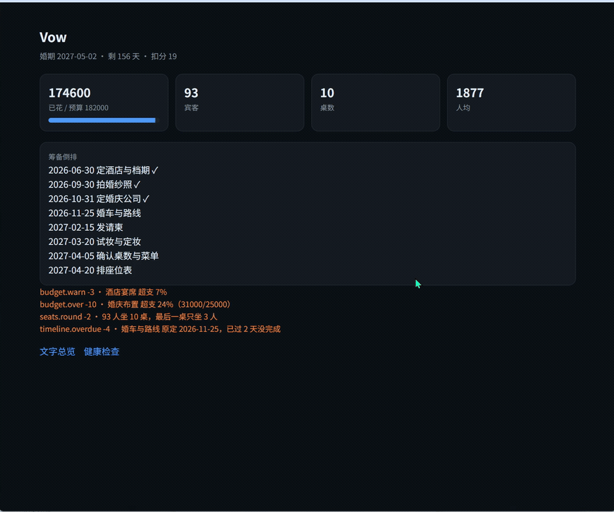

# Vow

[](https://github.com/wushiyi105-jpg/vow/actions)



Budget, vendors and a countdown, all pointed at one date.

## What it does

- warns at 5% and flags red at 15% over budget;
- keeps table count, per-table and per-person costs in sync;
- highlights overdue prep tasks;
- only shows hidden fees that can be quoted from the vendor text.

## Run

```bash
pip install -e ".[dev]"
python -m vow seed
python -m vow status --day 2026-11-27
python -m vow serve
```

## Author

shiyi · GitHub [@wushiyi105-jpg](https://github.com/wushiyi105-jpg) · wushiyi105@gmail.com
