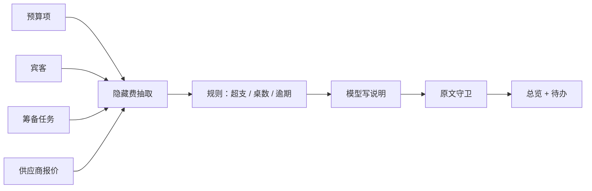

# Vow · wedding planning

[](https://github.com/wushiyi105-jpg/vow/actions)

[](./LICENSE)


Budget, vendors and a countdown, all anchored to the date.

## Features

- Warns at 5% category overspend, turns red at 15%.
- Converts guest count to tables (10 per table, rounded up) and keeps per-table and per-head figures in sync.
- Back-schedules milestones from the wedding date and highlights overdue ones.
- Extracts hidden fees from a vendor quote only when the exact source sentence is attached.

Rules live in `vow/domain/rules/`; the CLI and the web layer only call them. The Chinese README lists every `rule_id` with its penalty.

## Quickstart

```bash
pip install -e ".[dev]"
python -m vow seed
python -m vow status --day 2026-11-27
python -m vow vendor --vendor-id 1
python -m vow serve        # http://127.0.0.1:8008
```

Run `python -m vow --help` for the full command list; `docker build -t vow . && docker run -p 8008:8008 vow` works the same way.

## Why not just ask a general LLM

A spreadsheet will not keep per-head and per-table numbers consistent when you change the guest count, and it will not point at a line like “venue entry fee” buried in a quote. Vow does both, and refuses hidden fees without a source snippet.

## When to use it

- The date is fixed and you need to watch budget, guests and vendors together.
- Vendor quotes arrive as long text and you suspect add-ons.

## Roadmap

- Compare three vendors of the same category side by side.
- Share the budget with family, each editing their own part.

## FAQ

**How are quote amounts handled?**
You enter structured amounts; hidden fees are extracted with a mandatory source quote.

**Is the deposit counted as spent?**
No, deposits are tracked separately.

## Commands

See the Chinese README (`README.md`) for the command table with flags; every command supports `--help`.

## Dependencies

FastAPI + Uvicorn, Jinja2, pydantic / pydantic-settings, httpx, Typer + Rich, SQLAlchemy + Alembic; dev extras add pytest, pytest-cov, respx, freezegun, ruff, mypy, pip-audit. Version pinning lives in `uv.lock`.

## How it works



## Layout

```
vow/
├── .github/
│   ├── ISSUE_TEMPLATE
│   ├── PULL_REQUEST_TEMPLATE.md
│   └── workflows
├── assets/
│   └── demo.gif
├── data/
│   ├── seed.json
│   └── vow.db
├── migrations/
│   ├── __init__.py
│   ├── env.py
│   ├── script.py.mako
│   └── versions
├── prompts/
│   └── vendor.md
├── templates/
│   └── index.html
├── tests/
│   ├── __init__.py
│   ├── conftest.py
│   ├── test_budget_seats.py
│   ├── test_plan.py
│   ├── test_timeline_guard.py
│   └── test_web_cli.py
├── vow/
│   └── … 9 项
├── CHANGELOG.md
├── CODE_OF_CONDUCT.md
├── CONTRIBUTING.md
├── Dockerfile
├── LICENSE
├── README.en.md
├── README.md
├── SECURITY.md
├── alembic.ini
├── pyproject.toml
```

## Author

Dazhao · GitHub [@wushiyi105-jpg](https://github.com/wushiyi105-jpg) · 17382987315
