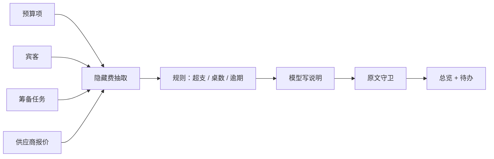

# Vow · 备婚

[](https://github.com/wushiyi105-jpg/vow/actions)

[](./LICENSE)


预算、供应商、倒排，全对着那个日子。


## 功能特性

1. **预算预警**：分类超 5% 黄、超 15% 红。
2. **桌数换算**：10 人一桌向上取整，每桌与人均同步。
3. **倒排**：从婚期反推节点，逾期未完成高亮。
4. **隐藏加价**：模型从报价里挑，必须附原文。
5. **定金**：单独累计，不混进已花。

### 规则与扣分

| rule_id | 含义 | 扣分 |
| --- | --- | --- |
| `budget.warn` | 分类超支 ≥ 5% | 3 |
| `budget.over` | 分类超支 ≥ 15% | 10 |
| `seats.round` | 最后一桌坐不满 | 2 |
| `timeline.overdue` | 节点逾期未完成 | 4 |
| `guard.hidden` | 隐藏项没有原文，丢弃 | 6 |

## 快速开始

```bash
pip install -e ".[dev]"
python -m vow seed
python -m vow status --day 2026-11-27
python -m vow vendor --vendor-id 1
python -m vow serve        # http://127.0.0.1:8008
```

真实种子：6 个预算项（计划 18.2 万、已花 17.46 万）、93 位宾客、8 个筹备任务、3 家供应商。
`status --day 2026-11-27`：宴席超 7%、婚庆超 24%（红）、宾客 93 人 10 桌最后一桌 3 人、
「婚车与路线」逾期 2 天。

## 为什么不用通用大模型直接问

Excel 不会在你改桌数时同步人均，也不会在报价里指出「进场费」这种原文写了但容易被忽略的项。
Vow 把桌数、人均、每桌价放在同一组函数里算，改人数三处一起动；报价里每条隐藏费必须附原文片段，
附不上就不展示。

## 适用场景

- 定了婚期，预算、宾客、供应商三头都要盯。
- 改桌数时希望人均和每桌价一起动，不用手算。
- 供应商报价是长文本，想找出「进场费」这种容易漏的项。

### 边界

- 不做请柬与签到，只管钱与时间；
- 桌数按 10 人一桌，可改常量；
- 供应商报价是纯文本，结构化金额要自己录。

## Roadmap

- 供应商比价库，同类三家放一起看。
- 预算共享给家人，各自只改自己那一块。
- 请柬与签到（现在只管钱和时间）。

## FAQ

**报价是纯文本，金额怎么算？**
结构化金额自己录；隐藏费由模型从原文里挑，挑不出原文片段就不展示。

**定金算已花吗？**
不算，单独累计。

**桌数怎么取整？**
10 人一桌向上取整，常量可改。

**Docker 镜像验证了吗？**
本机没有 Docker，`docker build .` 未执行，镜像未构建验证；Dockerfile 与端口只做了静态核对。

## 命令参考

| 命令 | 作用 | 常用参数 |
| --- | --- | --- |
| `seed` | 写入预算、宾客、任务与供应商。 | --db |
| `status` | 预算与倒排总览。 | --day, --db |
| `vendor` | 看某家供应商的隐藏项。 | --vendor-id, --db |
| `jobs` | 每日逾期扫描。 | --day, --run, --db |
| `doctor` | 四项体检。 | --db |
| `serve` | Web 界面。 | --port, --db |

全部命令都支持 `--help`；只读命令不带参数时读默认库 `data/vow.db`，写命令用 `--db` 指到别的库。

## 依赖说明

| 依赖 | 为什么装 | 不装会怎样 |
| --- | --- | --- |
| `fastapi` + `uvicorn[standard]` | Web 入口与 ASGI 服务 | 只有命令行，没有页面 |
| `jinja2` | 服务端渲染模板 | 页面出不来 |
| `pydantic` + `pydantic-settings` | 配置与数据结构校验，`.env` 直接生效 | 配置散在代码里，改端口要改源码 |
| `httpx` | 调模型与 webhook 的 HTTP 客户端 | 模型层与推送都不可用 |
| `typer` + `rich` | 命令行与终端表格 | 只能用 curl 调接口 |
| `sqlalchemy` + `alembic` | 本地库与迁移 | 表结构变更只能删库重来 |
| `pytest` / `pytest-cov` / `respx` / `freezegun`（dev） | 单测、覆盖率、HTTP 打桩、冻结时间 | 规则改动没有回归保护 |
| `ruff` / `mypy` / `pip-audit`（dev） | 风格、类型、依赖漏洞检查 | CI 只看测试，类型错误会漏进主干 |

装了 `uv` 的话，`uv sync --extra dev` 会按 `uv.lock` 装同一套版本。

## 工作原理




domain 里是预算、桌数、倒排与隐藏费守卫；app 负责总览。

## 目录结构

```
vow/
├── .github/
│   ├── ISSUE_TEMPLATE
│   ├── PULL_REQUEST_TEMPLATE.md
│   └── workflows
├── assets/
│   └── demo.gif
├── data/
│   ├── seed.json
│   └── vow.db
├── migrations/
│   ├── __init__.py
│   ├── env.py
│   ├── script.py.mako
│   └── versions
├── prompts/
│   └── vendor.md
├── templates/
│   └── index.html
├── tests/
│   ├── __init__.py
│   ├── conftest.py
│   ├── test_budget_seats.py
│   ├── test_plan.py
│   ├── test_timeline_guard.py
│   └── test_web_cli.py
├── vow/
│   └── … 9 项
├── CHANGELOG.md
├── CODE_OF_CONDUCT.md
├── CONTRIBUTING.md
├── Dockerfile
├── LICENSE
├── README.en.md
├── README.md
├── SECURITY.md
├── alembic.ini
├── pyproject.toml
```

## 作者

大钊 · GitHub [@wushiyi105-jpg](https://github.com/wushiyi105-jpg) · 17382987315
