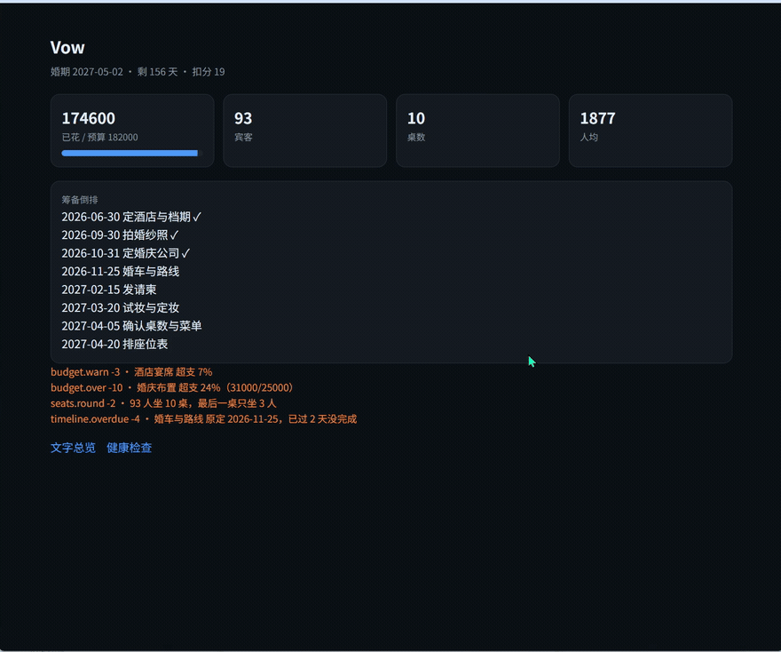

# Vow · 备婚

[](https://github.com/wushiyi105-jpg/vow/actions)

[](./LICENSE)



预算、供应商、倒排，全对着那个日子。

## 为什么不是一张 Excel

Excel 不会在你改桌数时同步人均，也不会在报价里指出「进场费」这种原文写了但容易被忽略的项。
Vow 把桌数、人均、每桌价放在同一组函数里算，改人数三处一起动；报价里每条隐藏费必须附原文片段，
附不上就不展示。

## 它做什么

1. **预算预警**：分类超 5% 黄、超 15% 红。
2. **桌数换算**：10 人一桌向上取整，每桌与人均同步。
3. **倒排**：从婚期反推节点，逾期未完成高亮。
4. **隐藏加价**：模型从报价里挑，必须附原文。
5. **定金**：单独累计，不混进已花。

## 怎么用

```bash
pip install -e ".[dev]"
python -m vow seed
python -m vow status --day 2026-11-27
python -m vow vendor --vendor-id 1
python -m vow serve        # http://127.0.0.1:8008
```

真实种子：6 个预算项（计划 18.2 万、已花 17.46 万）、93 位宾客、8 个筹备任务、3 家供应商。
`status --day 2026-11-27`：宴席超 7%、婚庆超 24%（红）、宾客 93 人 10 桌最后一桌 3 人、
「婚车与路线」逾期 2 天。

## 规则与扣分

| rule_id | 含义 | 扣分 |
| --- | --- | --- |
| `budget.warn` | 分类超支 ≥ 5% | 3 |
| `budget.over` | 分类超支 ≥ 15% | 10 |
| `seats.round` | 最后一桌坐不满 | 2 |
| `timeline.overdue` | 节点逾期未完成 | 4 |
| `guard.hidden` | 隐藏项没有原文，丢弃 | 6 |

## 边界

- 不做请柬与签到，只管钱与时间；
- 桌数按 10 人一桌，可改常量；
- 供应商报价是纯文本，结构化金额要自己录。

## 作者

shiyi · GitHub [@wushiyi105-jpg](https://github.com/wushiyi105-jpg) · wushiyi105@gmail.com

